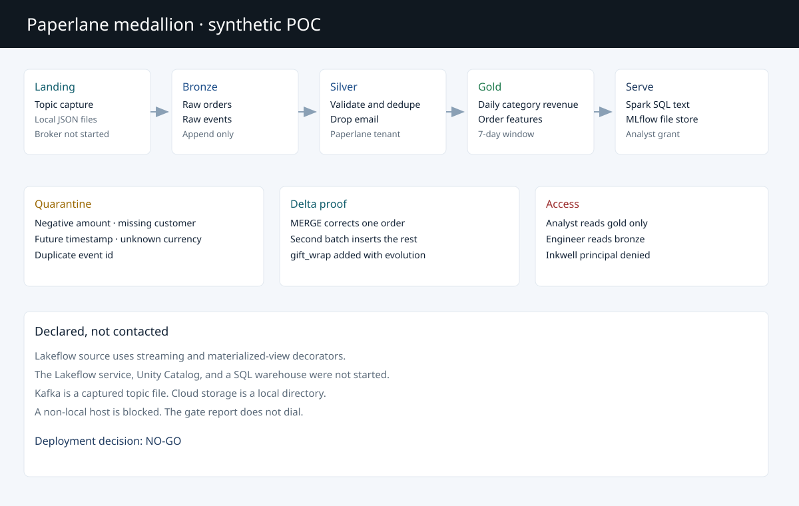
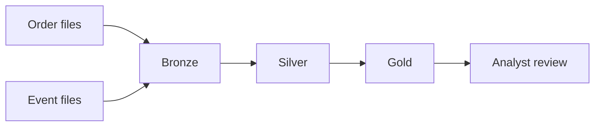
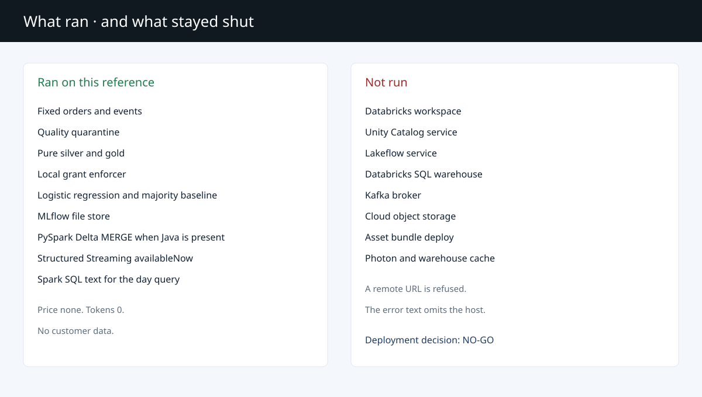

# Databricks lakehouse customer POC

Synthetic specialty retailer for a customer demonstration of medallion data, Delta incremental updates, access checks, Spark SQL, and a refund model. Organization `SYN-ORG-PAPERLANE`. Notice `SYNTHETIC_POC_NOT_A_DEPLOYMENT`.

This is not a Databricks workspace. Unity Catalog, Lakeflow, a SQL warehouse, a Kafka broker, and cloud storage were not contacted. The deployment decision is **NO-GO**.







## What the measurement decided

Keep the majority baseline. The rule was frozen before the score: recommend logistic only when its refund F1 beats the majority F1 by at least 0.05 and its false-positive rate is at most 0.20, at threshold 0.5.

On dataset `paperlane-v1-fixed-18`:

| Measure | Result |
| --- | --- |
| Clean orders | 240 |
| Data-quality failures | 10 |
| Silver orders | 240 |
| Silver events | 382 |
| Gold rows | 16 |
| Refunds | 16, of which 4 are in the holdout |
| Majority refund F1 | 0.0 |
| Logistic refund F1 | 0.0 |
| Logistic false-positive rate | 0.0 |
| Recommendation | `majority` |

The training majority label is non-refund, so the baseline refund F1 is 0. No holdout probability reached 0.5. The threshold was not lowered after the score. Tokens were 0. Price was none.

Local Spark SQL on 40,000 deterministic rows, 40 repeats, Spark 3.5.6, engine `spark-sql-local`. A SQL warehouse was not used.

| Layout | min | p50 | p95 | max |
| --- | --- | --- | --- | --- |
| Partitioned by `sale_date` | 0.3707848999911221 s | 0.4407844999950612 s | 0.5313135000033071 s | 0.6718191999971168 s |
| Unpartitioned scan | 0.3464862999971956 s | 0.397024899997632 s | 0.455856100001256 s | 0.4900269999925513 s |

The partitioned p50 is higher. This run does not show a pruning win. Hardware from the CIM query in that run: 11th Gen Intel(R) Core(TM) i7-1185G7 @ 3.00GHz, 4 cores, 8 logical processors, Python 3.12.10, Windows. Free physical memory was 8961196 KB of 32916868 KB.

## What a reviewer can run

```powershell
python -m venv .venv
.\.venv\Scripts\python.exe -m pip install -e ".[dev,spark]"
.\.venv\Scripts\python.exe -m pytest
.\.venv\Scripts\python.exe scripts\benchmark.py
.\.venv\Scripts\python.exe -m lakehouse_poc demo
.\.venv\Scripts\python.exe -m lakehouse_poc gates
```

`gates` prints the not-run table and does not open a socket. `demo` writes `reports/acceptance.json` and `reports/dashboard.html`. The static copy of the measured report is [docs/dashboard.html](docs/dashboard.html).

Windows Spark needs `JAVA_HOME` and a `.hadoop\bin` directory containing `winutils.exe` and `hadoop.dll`. Those binaries are not in git. Ubuntu GitHub-hosted runners already have Java and do not need them. On this Windows host, building a DataFrame from a Python list crashes the worker, so the job lands JSON lines and Spark reads the file.

Local pytest: 12 passed. Ruff was clean. Mypy was clean on 14 source files. Three of the tests start local Spark when Java is present.

## Layout

| Path | Role |
| --- | --- |
| `src/lakehouse_poc` | Synthetic data, quality, Delta helpers, catalog, model |
| `notebooks` | Two executable walkthroughs |
| `pipelines/paperlane_medallion.py` | Lakeflow source. The service was not started |
| `resources` | Unity Catalog SQL and an asset bundle. Neither was applied |
| `benchmarks/latest.json` | The measurement above |
| `docs` | Discovery, acceptance, demo script, limitations, diagrams |
| `docs/presentation` | Customer deck source and the generated slides |

## Limitations

Deployment decision: **NO-GO**.

Databricks, Kafka, Unity Catalog, Lakeflow, and the SQL warehouse stay not-run. A local image build was not run. The image proof is GitHub Actions `docker-build` check run 131801612988 in ci run 43400424053 on `50981fc27e26d3035a0601e598bcf44e6a2a340c`. The test check run is 131801613539. Security run 43400424021, scan check run 131801613186, succeeded on the same commit. All three annotation lists were empty. Details, including the solver warning and the Windows Spark binaries, are in [docs/limitations.md](docs/limitations.md). The 10–15 minute walkthrough is [docs/demo-script.md](docs/demo-script.md).

This repository was written in a Grok Build session. See [docs/ai-sdlc.md](docs/ai-sdlc.md).

## License

MIT. Copyright 2026 Jatinder Singh.
