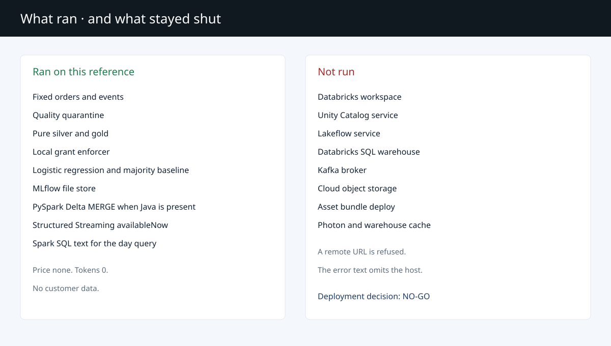

# Deployment

## Decision

NO-GO. The reference can rebuild the synthetic medallion on one machine. It is not cleared for a shared Databricks workspace or a customer subscription.

## Workstation path

This path produced `benchmarks/latest.json`.

- OS: Windows. Processor: 11th Gen Intel(R) Core(TM) i7-1185G7 @ 3.00GHz. 4 cores. 8 logical processors.
- At the benchmark CIM read, free physical memory was 8961196 KB and total visible memory was 32916868 KB.
- Python 3.12.10 in `.venv`. Portable Temurin 17.0.21+9 under `.jdk`. Spark 3.5.6 and Delta Spark 3.3.0.
- `.hadoop\bin` held `winutils.exe` and `hadoop.dll` for that run. Neither file is committed.
- Commands that ran: `ruff check`, `mypy`, `python -m pytest`, `python scripts/benchmark.py`.
- `python -m lakehouse_poc gates` prints the table and does not dial.

Docker and kubectl were not on this workstation's PATH. A local image build was not run. Compose was not started.

## Reference environment

The reproducible path is the venv, `pip install -e ".[dev,spark]"`, and pytest. Spark tests skip when Java is absent. They are not replaced by a claim that Lakeflow ran.

## GitHub Actions

`.github/workflows/ci.yml` on `ubuntu-24.04`:

| Job | What it runs |
| --- | --- |
| `test` | `pip install -e ".[dev,spark]"`, ruff, mypy, pytest |
| `docker-build` | `docker build` and `docker compose config`. The stack is not started |

`.github/workflows/security.yml` runs `scripts/reject_private_keys.py`. The private-key markers in that file are split so the scanner does not match itself.

Actions on `50981fc27e26d3035a0601e598bcf44e6a2a340c`:

| Workflow | Run | Check runs |
| --- | --- | --- |
| ci | 43400424053 | docker-build 131801612988, test 131801613539 |
| security | 43400424021 | scan 131801613186 |

Each of those three annotation lists was empty. Docker image proof is the `docker-build` check run above. A local Docker build was not run.

## Gates

| Variable | Unset | Local host | Other host |
| --- | --- | --- | --- |
| `DATABRICKS_HOST` | not-run | local only if it is a loopback host | blocked |
| `KAFKA_BOOTSTRAP` | not-run | local only if it is a loopback host | blocked |
| `CLOUD_URI` | not-run | a drive path or `file:` | blocked |

`unity_catalog`, `lakeflow_service`, and `sql_warehouse` are fixed at `not-run`. `LAKEHOUSE_ALLOW_REMOTE` stays unset. A blocked error does not include the host.
